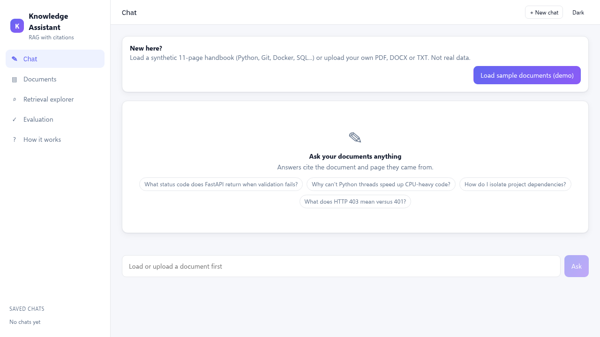
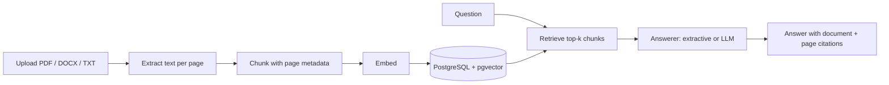

# Knowledge Assistant (RAG)

[](https://github.com/ZeyadMohamed00/rag-knowledge-assistant/actions/workflows/ci.yml)

Upload PDF / DOCX / TXT files, ask questions, get answers with citations (document + page number), saved chats. FastAPI + React/TypeScript + PostgreSQL with pgvector.

**Live app (free tier):** https://rag-web-puce.vercel.app  (click **Explore without signing up**, then **Load the example handbook**, and ask)
API + docs: https://rag-api-delta.vercel.app/docs



Pages: Chat, Documents, Retrieval explorer, Evaluation (from real eval runs) and How it works, with dark mode.

## System overview


**Tech stack:** FastAPI, PostgreSQL, pgvector, React, TypeScript, pypdf, python-docx, Pytest, Vitest, Docker.

## What it does
1. **Ingest**: extract text per page (pypdf for PDF, python-docx for DOCX), split into ~500-character sentence chunks with 1-sentence overlap, embed each chunk, store in `rag_chunks` (pgvector `vector(384)`).
2. **Retrieve**: embed the question, cosine-distance search in pgvector, filtered to the visitor's own documents.
3. **Answer**: with `OPENAI_API_KEY` set, an LLM answers only from the numbered context and cites `[n]`. Without a key, an **extractive** answerer returns the most relevant sentences with their citations. The UI shows which mode produced each answer.
4. **Saved chats**: messages and citations are stored per visitor (anonymous client id kept in the browser, no accounts).

## Stack
FastAPI, SQLAlchemy, PostgreSQL + pgvector, React + TypeScript (Vite), pypdf, python-docx, pytest + Vitest. Docker files are provided. LlamaIndex/LangChain are not used: the pipeline is ~150 lines of plain code so every step is visible and explainable.

## Honest status
- **Embeddings are lexical by default** (`EMBEDDING_PROVIDER=hash`: hashed word and bigram features, 384 dims). It runs anywhere with no model download, but it matches shared words, not paraphrases. Semantic embeddings are implemented behind `EMBEDDING_PROVIDER=openai` and have **not been run** (no API key here). Never mix providers in one database.
- **The LLM path is written but not run** (no API key here). The deployed demo uses the extractive answerer.
- **DOCX pages are approximate** (a new "page" every ~3000 characters) because .docx has no fixed pagination. PDFs use real pages. Scanned PDFs need OCR, which is not supported.
- Visitor limits: 10 documents each, 4 MB per file. The live demo shares a free Neon database (tables prefixed `rag_`).
- Docker files are not verified (no Docker in the build environment).

## Evaluation (real run, `python eval/run_eval.py`)
50 reference questions over the 11-page sample handbook; gold = the page holding the answer. Embedder: hash. Answerer: extractive. Results saved in `eval/results.json`.

| Metric | Value |
|---|---|
| Retrieval Recall@1 | 0.84 |
| Retrieval Recall@3 | 0.94 |
| Retrieval Recall@5 | 0.98 |
| MRR | 0.892 |
| Faithfulness (lexical proxy) | 0.967 |

Caveats: the questions were written by the project author from the same documents, so this is not an independent benchmark. **Faithfulness here is a lexical proxy** (share of answer sentences whose words appear in the retrieved context), not an LLM judge. An extractive answerer scores high on it by construction, so it only becomes informative with the LLM path. The one miss at k=5 is a paraphrase ("fast key lookup" vs "average constant time lookup"), the expected weakness of lexical embeddings.

## Run
```bash
docker compose up --build            # web on :8000 (API) + Postgres with pgvector (unverified here)
# or locally, with a pgvector-enabled Postgres:
pip install -r requirements.txt pgserver reportlab
DATABASE_URL=postgresql+psycopg2://user:pw@host/db uvicorn app.main:app
cd frontend && npm i && npm run dev
pytest                               # includes empty, oversized, corrupt-file and cross-client tests; uses an embedded real Postgres+pgvector (pgserver)
python eval/run_eval.py
```
Tests: 7 backend (real Postgres+pgvector) and 2 frontend pass.

## Key concepts
1. **RAG** = retrieve relevant chunks first, then answer only from them, so answers can be checked against sources.
2. **Chunking trade-off**: small chunks are precise but lose context, large ones keep context but add noise. I use ~500 chars with sentence overlap so facts are not cut in half.
3. **Embeddings + pgvector**: text becomes a vector; similar meaning (or, here, similar words) means a small cosine distance; Postgres does the nearest-neighbour search.
4. **Citations with page numbers** come from storing the page with every chunk at ingest time.
5. **Evaluation honesty**: Recall@k and MRR measure retrieval; faithfulness needs a judge. My default setup is lexical and extractive, and the numbers above say exactly that.

## Accounts and persistence
- **Real accounts:** `POST /auth/register`, `POST /auth/login`, `GET /auth/me`. Passwords are salted PBKDF2-SHA256 hashes; sessions are signed JWTs (7 days) sent as `Authorization: Bearer`. Set `JWT_SECRET` in production; if it is unset, a demo-only secret is derived from `DATABASE_URL` and a warning is logged.
- **Persistence:** a signed-in user's data is stored in PostgreSQL under their own account key (`user:<id>`) and is only reachable with their token. New accounts start empty.
- **Guest demo:** without logging in, "Continue as guest" uses an anonymous browser id with clearly labeled sample data. Guest ids can never collide with or impersonate an account.
- Tests: `tests/test_auth.py` (register, login, wrong or weak password, duplicate email, bad token, isolation) and `frontend/src/auth.test.tsx`.
- Login is throttled: 5 wrong passwords per email in 5 minutes returns `429` with `Retry-After` (`LOGIN_MAX_FAILS`, `LOGIN_FAIL_WINDOW_S`). The counter lives in process memory, so on several instances or serverless functions each one counts separately; use a shared limiter for hard guarantees. With `APP_ENV=production` a missing `JWT_SECRET` stops the app at startup instead of falling back.
- Not built: email verification, password reset and refresh tokens (listed as next steps).
